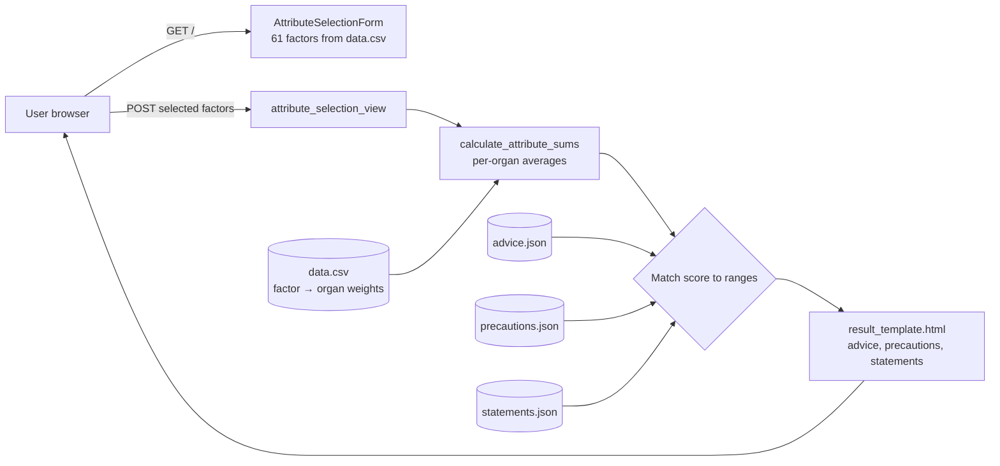

# Health Advice Prediction (Django)

A Django web app that turns a person's lifestyle and health factors into **organ-specific biological-age scores** (body, cardiac, pulmonary, muscle, immune, renal, hepatic, metabolic, brain) and returns tailored **health advice, precautions and motivational statements** for each organ system.


## Problem

Research on multi-organ aging (Tian et al., *Nature Medicine* 2023, [doi:10.1038/s41591-023-02296-6](https://doi.org/10.1038/s41591-023-02296-6)) shows that different organs age at different rates and that everyday factors, such as smoking, sleep, diet and physical activity, are associated with older or younger "biological age" in specific organs. Those findings are buried in papers. This app makes them actionable: users tick the factors that apply to them and get organ-level scores plus concrete next steps.

## Architecture



## Tech stack

| Layer | Tools |
|---|---|
| Backend | Python, Django 4.2 (function-based views, Django Forms) |
| Data | CSV (factor → organ weights), JSON knowledge base (advice, precautions, statements) |
| Frontend | Django templates |
| Process | Agile/Scrum: product backlog, sprint reports, system requirements |

## My role

Team project for *Software Systems Design & Implementation* at UNC Charlotte, run with an agile process. **I built the Django backend:** the models, the views and form handling, and the prediction logic that aggregates the selected factors into per-organ scores and maps them to advice, precautions and statements.

## How it works

1. `data.csv` lists 61 lifestyle and health factors, each with a weight per organ system. For example, *current tobacco smoking* raises the pulmonary and body scores.
2. The user selects the factors that apply to them.
3. For each organ, the backend averages the non-zero weights of the selected factors.
4. Each organ score is matched against score ranges in three JSON knowledge bases to pick the advice, precautions and a motivational statement.

## How to run

**Prerequisites:** Python 3.8+.

```bash
python -m venv .venv && source .venv/bin/activate
pip install -r requirements.txt

cp .env.example .env              # then set DJANGO_SECRET_KEY
export $(grep -v '^#' .env | xargs)

python manage.py migrate
python manage.py runserver        # open http://127.0.0.1:8000
```

Generate a secret key with:

```bash
python -c "from django.core.management.utils import get_random_secret_key as k; print(k())"
```

## Testing

```bash
pip install -r requirements-dev.txt
DJANGO_SECRET_KEY=test pytest -q
```

The 4 tests cover the factor form (all 61 factors render), organ-score computation and advice matching, empty submissions, and refusing to start without `DJANGO_SECRET_KEY`. They run on every push via GitHub Actions, along with `ruff`.

## Results

Verified end to end with Django's test client:

- `GET /` renders the form with all **61 factors**.
- Selecting *average weekly alcohol consumption*, *current tobacco smoking* and *past tobacco smoking* returns organ scores of **Pulmonary 2.6, Immune 2.0, Renal 2.0, Body 1.8, Brain 1.53, Metabolic 1.5**, and **Cardiac / Muscle / Hepatic 1.0**, plus matching advice blocks.

## Screenshots

_Coming soon: the factor-selection form and the results page._

## Repo structure

```
.
├── health_advice_prediction/    # Django project (settings read secrets from env)
├── health_prediction_app/
│   ├── views.py                 # scoring + advice matching
│   ├── forms.py                 # factor checklist built from data.csv
│   ├── models.py                # survey model (Post)
│   ├── data.csv                 # factor → organ weights
│   ├── advice.json / precautions.json / statements.json
│   └── templates/
├── manage.py
├── requirements.txt
└── .env.example
```
